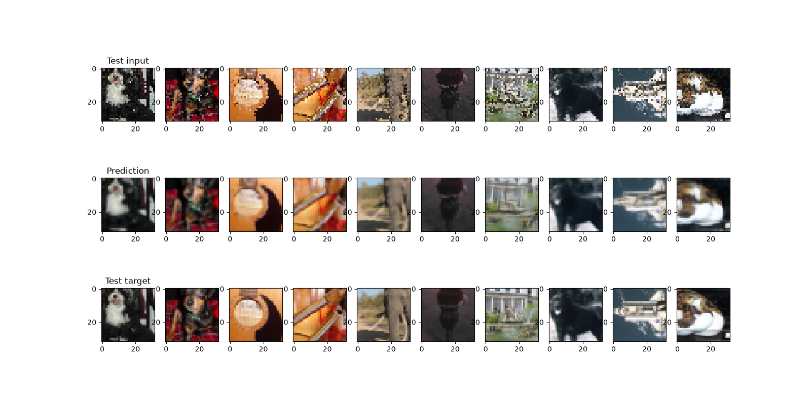
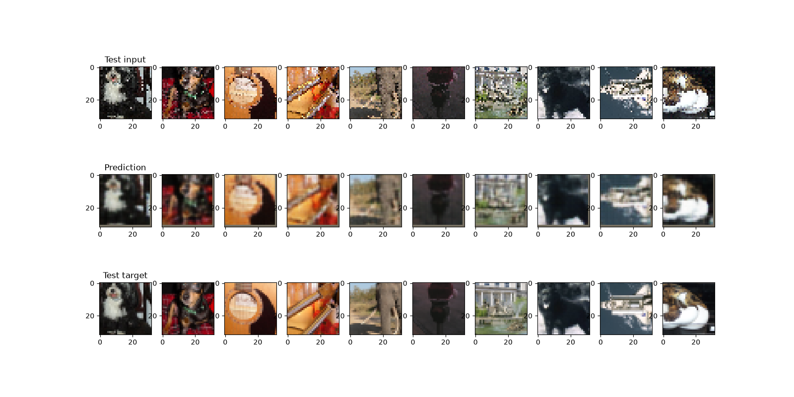

# Noise2Noise Image Denoising

Image denoising **without clean targets**, following the
[Noise2Noise](https://arxiv.org/abs/1803.04189) approach: a network learns to restore
images using only *another noisy version of the same image* as its target.

This repository contains two independent implementations of the same task:

| | Mini-project 1 | Mini-project 2 |
|---|---|---|
| **Goal** | Best possible denoiser with PyTorch | Deep learning framework written from scratch |
| **Tools** | `torch.nn`, autograd, Adam | Tensor operations only, hand-written backpropagation, SGD |
| **Model** | U-Net-style encoder-decoder with skip connections | Small convolutional encoder-decoder |

Developed as part of EE-559 (Deep Learning) at EPFL, spring 2022.
## Authors
[Jonathan](https://github.com/J-H3nry)
[Malika](https://github.com/inalbon)
[Ludovic](https://github.com/ludovicdauvin)

## The task

The data consists of 50,000 pairs of noisy, downsampled (pixelated) RGB images. Each pair shows
the same underlying image with different noise. The model is trained on input/target noisy pairs
and evaluated on a validation set with clean ground truth, using the **PSNR** metric.

## Mini-project 1: PyTorch denoiser

A convolutional encoder-decoder with skip connections, built from standard `torch.nn` modules
(`Conv2d`, `BatchNorm2d`, `LeakyReLU`, `MaxPool2d`, `Upsample`). It is trained with the Adam
optimizer and an MSE loss.

## Mini-project 2: framework from scratch

A minimal deep learning library with **no autograd and no `torch.nn` layers**. Forward and
backward passes are written by hand:

- `Conv2d` and `TransposeConv2d`, implemented with `unfold` / `fold` and matrix products
- `ReLU`, `Sigmoid`
- `MSE` loss
- `Sequential` container
- `SGD` optimizer

Weights are stored with the same convention as PyTorch: `(out_channels, in_channels, kh, kw)` for
`Conv2d` and `(in_channels, out_channels, kh, kw)` for `TransposeConv2d`. Weight initialization
uses `torch.nn.init` (Kaiming normal).

The trained network is:

```
Conv(stride 2) -> ReLU -> Conv(stride 2) -> ReLU -> TransposeConv(stride 2) -> ReLU -> TransposeConv(stride 2) -> Sigmoid
```

Each layer is validated against its PyTorch counterpart (forward and backward) in a test file.
Gradients are compared in `float64` to avoid rounding noise.

## Project structure

```
.
├── pyproject.toml
├── uv.lock
├── Miniproject_1/
│   ├── model.py
│   ├── bestmodel.pth
│   └── others/
        └── main.py
└── Miniproject_2/
    ├── model.py
    ├── test_mini_p2.py
    ├── bestmodel2.pth
    └── others/
        └── main.py
```

## Getting started

This project uses [uv](https://docs.astral.sh/uv/).

```bash
git clone https://github.com/<your-account>/<your-repo>.git
cd <your-repo>
uv sync
```

The environment is defined in `pyproject.toml`. A CUDA-enabled PyTorch build is selected through
the PyTorch index configured there; adapt it to your driver if needed. This project uses python 3.12
and Pytorch 2.14.1 for Cuda 13.2

### Data

The datasets are **not included** in this repository. Place `train_data.pkl` and `val_data.pkl`
at the root of the repository (they are ignored by git).

### Run

```bash
# Train and visualize results (mini-project 1)
uv run python Miniproject_1/others/main.py

# Train and visualize results (mini-project 2)
uv run python Miniproject_2/others/main.py

# Run the layer tests (mini-project 2)
uv run python Miniproject_2/test_mini_p2.py
```

<!-- TODO: add the possibility to disable training via command line -->

## Results

| Model | Validation PSNR |
|---|---|
| Mini-project 1 (PyTorch) | TODO dB |
| Mini-project 2 (from scratch) | TODO dB |

# Results from Mini-project 1


*Mini-project 1: noisy input, denoised output and clean target (validation set).*

# Results from Mini-project 2


*Mini-project 2: noisy input, denoised output and clean target (validation set).*
Disclaimer: This result is probably not the best possible using the custom network, the bestmodel2.pth
was obtained using a simple gridsearch on the Learning rate value.

## Notes

- `bestmodel.pth` files are Python pickles. Only load files you trust.
- This is an educational project: the from-scratch framework favours clarity over speed.

## License

See [LICENSE](LICENSE).
